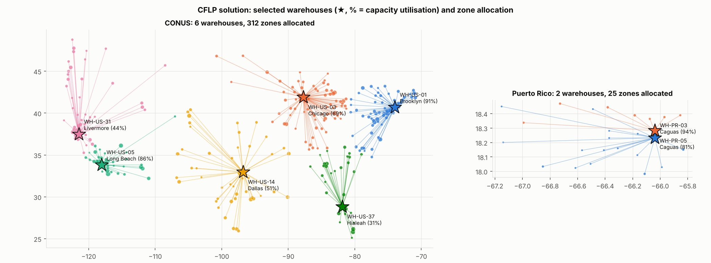
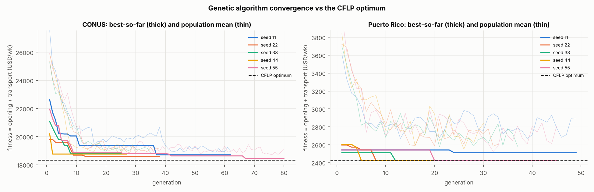
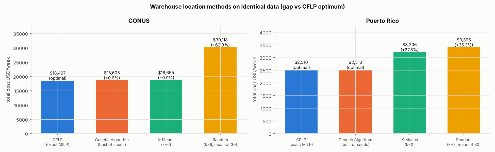
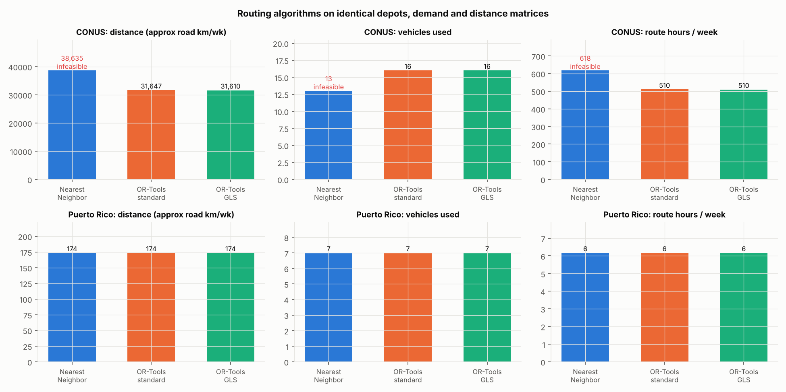
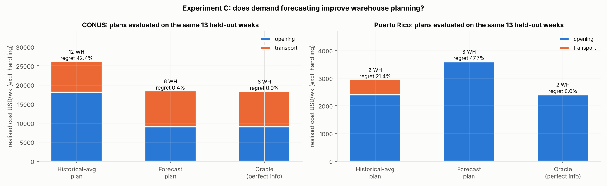
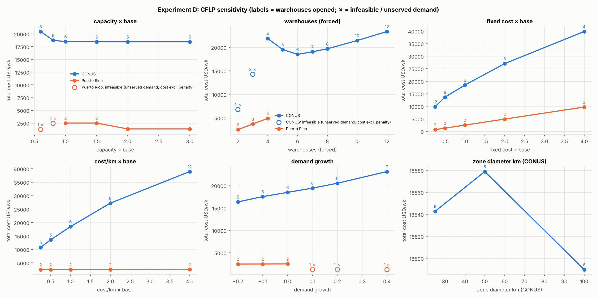
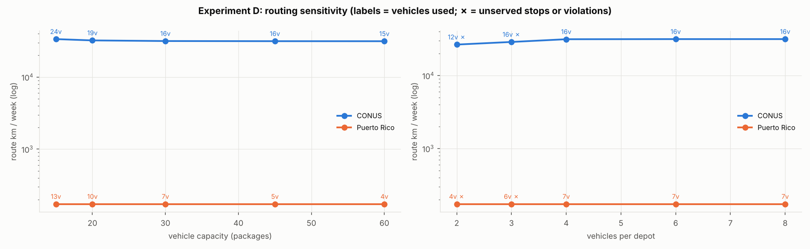
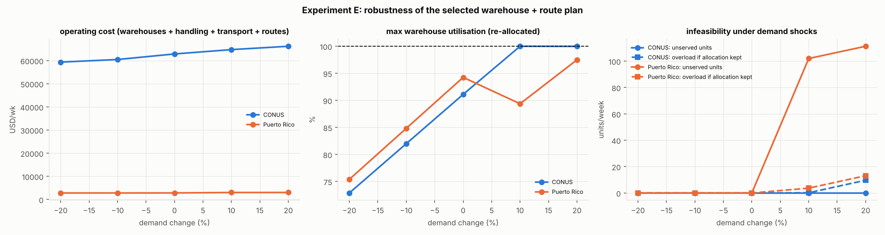

# Demand-Driven E-Commerce Warehouse Location and Multi-Vehicle Delivery Route Optimisation Using Hybrid Optimisation Algorithms

_Final project report. It is generated by `python main.py report` from the pipeline outputs in `data/outputs/`. Every number in it is computed. Costs, capacities and fleet parameters are documented **simulation assumptions** (`config.yaml`). The dataset contains none of them._

## 1. Abstract

The system was built and evaluated on the DataCo Smart Supply Chain dataset (180,519 order-item rows, 62,011 valid orders after cleaning). It runs in stages:

1. Order-item records are aggregated into deliveries and into bounded-diameter demand zones in two separate logistics networks: the contiguous US (CONUS) and Puerto Rico.
2. Zone demand is forecast with regime-aware methods, because the data change abruptly in October 2017.
3. Warehouses are located with an exact Capacitated Facility Location Problem (CFLP), solved with Pyomo and CBC.
4. A DEAP Genetic Algorithm (GA), K-Means and random selection serve as comparison methods.
5. Weekly delivery routes are built per depot with a CVRP, solved by OR-Tools with Guided Local Search (GLS).

Results:

* **CFLP:** solved to proven optimality in both networks. It opens 6 CONUS and 2 Puerto Rico warehouses.
* **CFLP vs random selection** (same number of warehouses): 38.6% lower total cost in CONUS and 26.1% lower in Puerto Rico.
* **CFLP vs K-Means:** 0.85% lower in CONUS and 21.7% lower in Puerto Rico.
* **Genetic Algorithm:** its best configuration is 0.58% above the optimum in CONUS and 0.00% above it in Puerto Rico.
* **Routing:** GLS shortens CONUS routes by 18.2% versus Nearest Neighbor. The Nearest Neighbor routes also violate the route-length limit. GLS gains only 0.12% over the standard OR-Tools search.
* **Forecast-based vs historical-average planning** (13 held-out weeks): realised cost is 29.5% lower with forecasts in CONUS, but **21.6% higher** in Puerto Rico. The Puerto Rico unit forecast was biased high, which forced an extra warehouse.

## 2. Introduction

E-commerce fulfilment cost is dominated by two coupled decisions:

* a **strategic** decision: where warehouses are opened, and which customers each one serves;
* an **operational** decision: how vehicles deliver from those warehouses.

Both decisions depend on demand, which must be forecast. This project chains the three steps (forecasting → facility location → vehicle routing) into one reproducible pipeline. Each optimisation step is compared against simpler baselines on identical inputs.

## 3. Problem statement

Given historical customer orders, the system must decide:

1. where to open warehouses and how many;
2. which warehouse serves each demand zone, within warehouse capacity;
3. how many vehicles each warehouse needs and which zones each vehicle visits, in which order, within vehicle capacity.

The goal is to minimise warehouse opening cost, transport cost and route distance. Every constraint must be respected, and all unserved demand must be reported explicitly.

## 4. Research objectives

1. Build a leakage-free demand forecast at zone level and select the method by measured accuracy.
2. Solve the single-sourcing CFLP exactly, and quantify its advantage over heuristic and naive placement.
3. Test whether a Genetic Algorithm reaches the exact optimum, and at what computational cost.
4. Route vehicles with GLS, and quantify its gain over constructive and standard local-search methods.
5. Measure whether forecasting improves warehouse planning against realised demand.
6. Measure the sensitivity and robustness of the solution to the simulated assumptions.

## 5. Dataset description

* **Source:** DataCo Smart Supply Chain for Big Data Analysis (Kaggle `shashwatwork/dataco-smart-supply-chain-for-big-data-analysis`).
* **Size:** 180,519 order-item rows × 53 columns, covering 65,752 orders from January 2015 to January 2018.
* **Coordinates:** the only coordinates are customer-side `Latitude`/`Longitude` (US and Puerto Rico). Destination fields (`Order City`/`Order Country`, 164 countries) have no coordinates. They are statistically independent of customer location (Cramér's V ≈ 0.01), so demand is placed at customer coordinates. International destinations are never routed.
* **Missing business data:** the dataset has no warehouses, capacities, costs, fleet, package weights or road distances. All of these are simulation assumptions (§13).
* **Personal data:** customer names and streets are present in the raw file. They are dropped before any output is written, and tests enforce this.

## 6. Data preprocessing methodology

* **Flag, don't delete.** Rows are flagged rather than deleted, and every decision is logged (`data_quality_report.csv`).
* **Non-demand orders:** cancelled and suspected-fraud orders never ship, so they are excluded from demand.
* **Invalid coordinates excluded:** sign flips, truncated longitudes, a placeholder point near the US centroid, and points more than 1,000 km from their state's median location.
* **Demand set:** 62,011 orders and 361,965 units remain. Order-item rows are aggregated into one row per order (= one delivery).
* **Demand zones:** complete-linkage clustering with a guaranteed maximum diameter (CONUS 50 km, island networks 10 km). This gives 312 CONUS zones and 25 Puerto Rico zones. Hawaii (6 zones) is analysis-only.
* **Reconciliation:** 37 checks confirm that units, orders, items and sales are conserved from items to orders to zone-days.

## 7. Demand forecasting methodology

* **Panel:** zone × complete week (Sunday–Saturday). The week of 2017-10-01 starts exactly at a distribution break, after which units per order fall from about 6.5 to about 1. Orders and units are forecast separately.
* **Methods compared:** historical average, moving average, Random Forest and XGBoost (global models).
* **Features:** lags, rolling means, shares and calendar features, built strictly from past periods. A test perturbs future values and checks that no past feature changes.
* **Splits:** chronological train/validation/test, before and after the break.
* **Post-break evaluation:** 4 post-break weeks are observed, then 13 held-out weeks are forecast.
* **Selection:** per network and target, the lowest **zone-total WAPE** over those 13 weeks. That is the quantity the CFLP consumes.

Stable regime, zone-week WAPE (one-step):

| target | network | historical_average | moving_average | random_forest | xgboost |
|---|---|---|---|---|---|
| orders | CONUS | 0.726 | 0.736 | 0.748 | 0.743 |
| orders | Puerto Rico | 0.167 | 0.175 | 0.172 | 0.185 |
| units | CONUS | 0.830 | 0.838 | 0.852 | 0.846 |
| units | Puerto Rico | 0.188 | 0.191 | 0.193 | 0.174 |

Post-break adapted window, zone-total WAPE (13 held-out weeks):

| target | network | historical_average [none] | historical_average [recalibrated] | moving_average [none] | moving_average [recalibrated] | post_break_average [regime_reset] | random_forest [none] | random_forest [recalibrated] | share_x_recent_level [regime_reset] | xgboost [none] | xgboost [recalibrated] |
|---|---|---|---|---|---|---|---|---|---|---|---|
| orders | CONUS | 0.287 | 0.243 | 0.319 | 0.317 | 0.410 | 0.299 | 0.257 | 0.242 | 0.314 | 0.286 |
| orders | Puerto Rico | 1.659 | 1.772 | 1.263 | 1.294 | 0.254 | 1.116 | 1.154 | 1.770 | 1.036 | 1.093 |
| units | CONUS | 4.256 | 0.305 | 2.857 | 0.356 | 0.550 | 4.364 | 0.304 | 0.314 | 4.311 | 0.339 |
| units | Puerto Rico | 5.622 | 1.998 | 4.009 | 1.716 | 0.462 | 3.946 | 1.171 | 2.012 | 1.772 | 1.001 |

Selected models:

| target | network | model | handling | WAPE | MAE | RMSE | bias_pct |
|---|---|---|---|---|---|---|---|
| orders | CONUS | share_x_recent_level | regime_reset | 0.242 | 2.806 | 4.259 | 0.004 |
| orders | Puerto Rico | post_break_average | regime_reset | 0.254 | 23.210 | 54.697 | -0.030 |
| units | CONUS | random_forest | recalibrated | 0.304 | 3.520 | 6.203 | 0.188 |
| units | Puerto Rico | post_break_average | regime_reset | 0.462 | 42.190 | 111.364 | 0.204 |

**XGBoost was not selected for any target or network.** Two reasons:

* Zone-week demand is near-stationary count noise around a level, so there is little nonlinear structure for boosting to exploit.
* The decisive post-break problem is a shift in level and location, which no model trained on pre-break data can learn.

Puerto Rico's demand relocated about 35 km within the island at the break, so a regime-reset estimator was selected there.

## 8. CFLP mathematical formulation

Sets: zones $i\in I$ and candidate sites $j\in J$ (one model per network). Parameters: forecast orders $o_i$ and units $u_i$ per week, approximate road distance $d_{ij}$, fixed cost $F_j$, capacity $Q_j$ and cost per order-km $c$. Binary decision variables are $Y_j$ (open site $j$) and $X_{ij}$ (zone $i$ is served by $j$).

$$\min\ Z=\sum_j F_jY_j+\sum_i\sum_j C_{ij}X_{ij},\qquad C_{ij}=c\,d_{ij}\,o_i$$

$$\text{s.t.}\quad\sum_j X_{ij}=1\ \forall i;\quad \sum_i u_iX_{ij}\le Q_jY_j\ \forall j;\quad X_{ij}\le Y_j\ \forall i,j;\quad p_{min}\le\sum_jY_j\le p_{max};\quad X,Y\in\{0,1\}.$$

* **Orders drive transport, units drive capacity.** Each order is one delivery, so orders determine transport cost. Warehouses store and handle units, so units consume capacity.
* **Constant handling cost:** a uniform cost of $0.5/unit is added for reporting only. It does not change the optimum.
* **Tighter relaxation:** the disaggregated linking constraints $X_{ij}\le Y_j$ give a much tighter LP relaxation than the aggregated form.
* **Over-capacity cases:** for experiments, penalised slack variables report unserved demand instead of failing silently.
* **Candidate sites:** 37 in CONUS, from demand-weighted k-means coverage sites plus the highest-demand zones. All 25 zones in Puerto Rico.
* **Distances:** great-circle distance × 1.2 circuity (OSRM was not reachable). These are **approximate** road distances, not road-network distances.
* **Complexity:** the problem is NP-hard. CBC solves it by branch-and-cut with LP relaxations.

| network | termination | proven_optimal | objective_excl_handling | lower_bound | relative_gap | runtime_s | n_zones | n_candidates | n_variables | n_constraints |
|---|---|---|---|---|---|---|---|---|---|---|
| CONUS | optimal | 1 | 18,348.36 | 18,348.36 | 0.00 | 0.96 | 312 | 37 | 11,893 | 11,895 |
| Puerto Rico | optimal | 1 | 2,421.76 | 2,421.76 | 0.00 | 0.07 | 25 | 25 | 675 | 677 |

Selected warehouses:

| network | warehouse_id | dominant_city | dominant_state | assigned_zones | assigned_orders_per_week | assigned_units_per_week | capacity_units_per_week | utilization_pct |
|---|---|---|---|---|---|---|---|---|
| CONUS | WH-US-01 | Brooklyn | NY | 64 | 70.85 | 72.88 | 80.00 | 91.10 |
| CONUS | WH-US-03 | Chicago | IL | 81 | 51.18 | 55.55 | 80.00 | 69.43 |
| CONUS | WH-US-05 | Long Beach | CA | 39 | 65.41 | 68.51 | 80.00 | 85.64 |
| CONUS | WH-US-14 | Dallas | TX | 49 | 37.43 | 40.46 | 80.00 | 50.58 |
| CONUS | WH-US-31 | Livermore | CA | 48 | 31.23 | 35.24 | 80.00 | 44.04 |
| CONUS | WH-US-37 | Hialeah | FL | 31 | 23.40 | 25.17 | 80.00 | 31.46 |
| Puerto Rico | WH-PR-03 | Caguas | PR | 17 | 94.25 | 94.25 | 100.00 | 94.25 |
| Puerto Rico | WH-PR-05 | Caguas | PR | 8 | 81.25 | 81.25 | 100.00 | 81.25 |

## 9. Genetic Algorithm methodology

* **Chromosome:** a binary vector $y\in\{0,1\}^{|J|}$, where gene $j$ = 1 means candidate $j$ is open. A **repair** operator keeps the number of open sites between the capacity-implied minimum and $p_{max}$.
* **Fitness (minimised):** $\sum_jF_jy_j+\text{transport}(A(y))+M\cdot\text{unserved}(y)$. Here $A(y)$ allocates zones to open sites with a capacity-feasible regret heuristic plus shift improvement, so it never overloads a warehouse; zones that fit nowhere are unserved and penalised. The data and costs are the same as in the CFLP.
* **Fair final comparison:** the best chromosome of each run is re-allocated with the **exact** subproblem (CBC with $Y$ fixed), so its cost is directly comparable with the CFLP optimum.
* **Operators:**
  * tournament selection (k = 3);
  * two-point crossover (p = 0.8);
  * bit-flip mutation (p = 0.3 per individual, 1/|J| per gene);
  * elitism (2);
  * population 60, at most 80 generations, early stop after 25 generations without improvement;
  * 5 seeds.
* **Complexity:** each fitness evaluation costs O(I²·p) for the regret allocation. The search space is about 3.2×10⁹ configurations in CONUS, so exhaustive enumeration is impossible. The GA explores it with a few thousand evaluations.

| network | runs | best | mean | std | mean_generations | mean_unique_evals | mean_runtime_s | cflp_optimum | runs_reaching_optimum |
|---|---|---|---|---|---|---|---|---|---|
| CONUS | 5 | 18,604.64 | 18,813.07 | 122.85 | 48.40 | 623.80 | 14.40 | 18,497.26 | 0.00 |
| Puerto Rico | 5 | 2,509.51 | 2,527.35 | 35.68 | 38.80 | 364.60 | 0.33 | 2,509.51 | 4.00 |

## 10. CVRP mathematical formulation

For each depot (an open warehouse), with node 0 = depot, stops $1..n$ and vehicles $k$:

$$\min\sum_k\sum_i\sum_j d_{ij}x_{ijk}\quad\text{s.t. each stop is visited exactly once; each route starts and ends at the depot; }\sum_{i\in r_k}q_i\le Q_v;\ \text{length}(r_k)\le L_{max};\ |\{k\}|\le K.$$

* **Planning period:** one week of consolidated deliveries.
* **Stops:** each demand-zone centroid with at least one package is a stop. One package = one forecast order, since the data has no weights or volumes. Packages are apportioned per depot with the largest-remainder method, which preserves the expected total.
* **Split deliveries:** a stop with more packages than one vehicle holds is split into several stops at the same location.
* **No mainland–island routes:** stops come only from zones allocated to the depot, so routes never cross between the mainland and Puerto Rico.
* **Parameters:** CONUS vehicles carry 30 packages, with L_max = 3000 km and 8 vehicles per depot. Puerto Rico L_max = 400 km. Speeds are 65 / 40 km/h, plus 10 min service per stop.
* **Unserved stops:** each stop is in a penalised disjunction, so any unserved stop is reported, never hidden.

## 11. Guided Local Search methodology

1. **Initial solution:** PATH_CHEAPEST_ARC repeatedly extends a route with the cheapest feasible arc.
2. **Local search neighbourhoods:** relocate, exchange, 2-opt, Or-opt, cross and inter-route moves, all evaluated under the capacity and distance dimensions.
3. **Cost:** the sum of arc distances. Penalties for dropped stops are added.
4. **Features and penalties:** GLS treats each arc as a feature with cost $c_a$. At a local minimum it penalises the arcs with maximal utility $c_a/(1+p_a)$ by incrementing $p_a$.
5. **Augmented objective:** the search continues on $g(s)=\text{cost}(s)+\lambda\sum_a p_a I_a(s)$.
6. **Escaping local minima:** penalised long arcs make neighbouring solutions relatively cheaper. This moves the search out of local minima that plain greedy descent (the standard baseline) cannot leave.
7. **Termination:** a time limit of 10 s per depot. The best solution under the *true* cost is returned.

## 12. Hybrid optimisation architecture

Raw data → cleaning → demand zones → forecasting → candidate generation → **CFLP (exact)** → **GA / K-Means / random (comparison)** → selected configuration (lowest exact cost) → allocation → **CVRP (NN / standard / GLS)** → experiments → dashboard & reports.

The pipeline is driven by `main.py` (`preprocess, forecast, warehouse, genetic, routing, evaluate, report, all`) and configured by `config.yaml`. The configuration of each stage is saved in `data/outputs/run_configs/`.

## 13. Experimental setup

Simulation assumptions (weekly planning period; annual = ×52):

| network | min_warehouses | max_warehouses | capacity_units_per_week | fixed_cost_per_week | cost_per_order_km | handling_cost_per_unit | vehicle_capacity | vehicles_per_depot | max_route_km |
|---|---|---|---|---|---|---|---|---|---|
| CONUS | 1 | 12 | 80 | 1,500 | 0.10 | 0.50 | 30 | 8 | 3,000 |
| Puerto Rico | 1 | 4 | 100 | 1,200 | 0.10 | 0.50 | 30 | 8 | 400 |

* **Comparability:** all methods use identical demand, candidates, distances, capacities and costs.
* **Reproducibility:** seeds are fixed. The CFLP is deterministic.
* **GLS timing:** GLS is time-limited, so its results can vary slightly between machines.

## 14. Performance comparisons

### Experiment A: warehouse location

| network | method | n_open | opening_cost | transport_cost | total_cost | avg_distance_km_order_weighted | mean_utilization | unserved_units | feasible | runtime_s | gap_vs_cflp_pct |
|---|---|---|---|---|---|---|---|---|---|---|---|
| CONUS | CFLP (exact MILP) | 6.00 | 9,000.00 | 9,348.36 | 18,497.26 | 334.47 | 62.04 | 0.00 | 1 | 0.83 | 0.00 |
| CONUS | Genetic Algorithm (best of seeds) | 6.00 | 9,000.00 | 9,455.74 | 18,604.64 | 338.31 | 62.04 | 0.00 | 1 | 72.00 | 0.58 |
| CONUS | K-Means (k=6) | 6.00 | 9,000.00 | 9,506.45 | 18,655.35 | 340.12 | 62.04 | 0.00 | 1 | 0.48 | 0.85 |
| CONUS | Random (k=6, mean of 30) | 6.00 | 9,000.00 | 20,968.90 | 30,117.80 | 750.23 | 62.04 | 0.00 | 1 | 24.57 | 62.82 |
| Puerto Rico | CFLP (exact MILP) | 2.00 | 2,400.00 | 21.76 | 2,509.51 | 1.24 | 87.75 | 0.00 | 1 | 0.05 | 0.00 |
| Puerto Rico | Genetic Algorithm (best of seeds) | 2.00 | 2,400.00 | 21.76 | 2,509.51 | 1.24 | 87.75 | 0.00 | 1 | 1.64 | 0.00 |
| Puerto Rico | K-Means (k=2) | 2.00 | 2,400.00 | 718.64 | 3,206.39 | 40.95 | 87.75 | 0.00 | 1 | 0.07 | 27.77 |
| Puerto Rico | Random (k=2, mean of 30) | 2.00 | 2,400.00 | 906.94 | 3,394.69 | 51.68 | 87.75 | 0.00 | 1 | 1.54 | 35.27 |

### Experiment B: delivery routing

| network | method | vehicles | total_distance_km | total_duration_h | total_route_cost | fleet_utilization_pct | capacity_violations | route_length_violations | unserved_stops | all_feasible | runtime_s |
|---|---|---|---|---|---|---|---|---|---|---|---|
| CONUS | nearest_neighbor | 13 | 38,635.49 | 617.73 | 54,078.63 | 71.28 | 0 | 5 | 0 | 0 | 0.00 |
| CONUS | ortools_gls | 16 | 31,610.44 | 509.65 | 44,351.63 | 57.92 | 0 | 0 | 0 | 1 | 60.01 |
| CONUS | ortools_standard | 16 | 31,647.27 | 510.21 | 44,402.63 | 57.92 | 0 | 0 | 0 | 1 | 0.17 |
| Puerto Rico | nearest_neighbor | 7 | 173.58 | 6.17 | 327.90 | 83.33 | 0 | 0 | 0 | 1 | 0.00 |
| Puerto Rico | ortools_gls | 7 | 173.58 | 6.17 | 327.90 | 83.33 | 0 | 0 | 0 | 1 | 20.00 |
| Puerto Rico | ortools_standard | 7 | 173.58 | 6.17 | 327.90 | 83.33 | 0 | 0 | 0 | 1 | 0.01 |

### Experiment C: forecasting impact on warehouse placement

Both planners stand at 2017-10-28 with the same information. Each plan is evaluated on the realised demand of the 13 following weeks, with zones re-allocated optimally to the plan's warehouses (recourse). The oracle uses realised demand (perfect information).

| network | scenario | planned_units_per_week | warehouses_opened | realised_opening_cost | realised_transport_cost | realised_total_cost | realised_unserved_units | capacity_violation_units_if_plan_kept | regret_vs_oracle_pct | plan_proven_optimal | plan_relative_gap |
|---|---|---|---|---|---|---|---|---|---|---|---|
| CONUS | 1: historical average demand | 1,461.62 | 12 | 18,000.00 | 8,237.95 | 26,377.06 | 0.00 | 0.00 | 42.43 | 0 | 0.01 |
| CONUS | 2: selected forecast demand | 330.58 | 6 | 9,000.00 | 9,455.27 | 18,594.38 | 0.00 | 0.00 | 0.40 | 1 | 0.00 |
| CONUS | oracle: realised demand (perfect information) | 278.23 | 6 | 9,000.00 | 9,380.50 | 18,519.62 | 0.00 | 0.00 | 0.00 | 1 | 0.00 |
| Puerto Rico | 1: historical average demand | 935.57 | 2 | 2,400.00 | 556.99 | 3,044.72 | 0.00 | 74.15 | 21.45 | 1 |  |
| Puerto Rico | 2: selected forecast demand | 211.25 | 3 | 3,600.00 | 14.89 | 3,702.62 | 0.00 | 0.00 | 47.69 | 1 | 0.00 |
| Puerto Rico | oracle: realised demand (perfect information) | 175.46 | 2 | 2,400.00 | 19.34 | 2,507.07 | 0.00 | 0.00 | 0.00 | 1 | 0.00 |

## 15. Sensitivity analysis (Experiment D)

| network | parameter | value | n_open | opening_cost | transport_cost | total_cost | avg_distance_km_order_weighted | unserved_units | feasible | termination |
|---|---|---|---|---|---|---|---|---|---|---|
| CONUS | capacity_multiplier | 0.60 | 8.00 | 12,000.00 | 8,329.77 | 20,478.67 | 298.02 | 0.00 | 1 | maxTimeLimit |
| CONUS | capacity_multiplier | 0.80 | 6.00 | 9,000.00 | 9,604.57 | 18,753.48 | 343.63 | 0.00 | 1 | optimal |
| CONUS | capacity_multiplier | 1.00 | 6.00 | 9,000.00 | 9,348.36 | 18,497.26 | 334.47 | 0.00 | 1 | optimal |
| CONUS | capacity_multiplier | 1.50 | 5.00 | 7,500.00 | 10,799.84 | 18,448.74 | 386.40 | 0.00 | 1 | optimal |
| CONUS | capacity_multiplier | 2.00 | 5.00 | 7,500.00 | 10,799.84 | 18,448.74 | 386.40 | 0.00 | 1 | optimal |
| CONUS | capacity_multiplier | 3.00 | 5.00 | 7,500.00 | 10,799.84 | 18,448.74 | 386.40 | 0.00 | 1 | optimal |
| CONUS | fixed_warehouse_count | 2.00 | 2.00 | 3,000.00 | 3,692.10 | 6,772.09 | 250.20 | 137.84 | 0 | maxTimeLimit |
| CONUS | fixed_warehouse_count | 3.00 | 3.00 | 4,500.00 | 9,646.13 | 14,266.10 | 430.91 | 57.87 | 0 | maxTimeLimit |
| CONUS | fixed_warehouse_count | 4.00 | 4.00 | 6,000.00 | 15,710.73 | 21,859.63 | 562.10 | 0.00 | 1 | maxTimeLimit |
| CONUS | fixed_warehouse_count | 5.00 | 5.00 | 7,500.00 | 11,882.64 | 19,531.54 | 425.14 | 0.00 | 1 | optimal |
| CONUS | fixed_warehouse_count | 6.00 | 6.00 | 9,000.00 | 9,348.36 | 18,497.26 | 334.47 | 0.00 | 1 | optimal |
| CONUS | fixed_warehouse_count | 7.00 | 7.00 | 10,500.00 | 8,398.62 | 19,047.52 | 300.49 | 0.00 | 1 | optimal |
| CONUS | fixed_warehouse_count | 8.00 | 8.00 | 12,000.00 | 7,533.65 | 19,682.55 | 269.54 | 0.00 | 1 | optimal |
| CONUS | fixed_warehouse_count | 10.00 | 10.00 | 15,000.00 | 6,290.41 | 21,439.31 | 225.06 | 0.00 | 1 | optimal |
| CONUS | fixed_warehouse_count | 12.00 | 12.00 | 18,000.00 | 5,206.17 | 23,355.08 | 186.27 | 0.00 | 1 | optimal |
| CONUS | fixed_cost_multiplier | 0.25 | 12.00 | 4,500.00 | 5,206.17 | 9,855.08 | 186.27 | 0.00 | 1 | optimal |
| CONUS | fixed_cost_multiplier | 0.50 | 8.00 | 6,000.00 | 7,533.65 | 13,682.55 | 269.54 | 0.00 | 1 | optimal |
| CONUS | fixed_cost_multiplier | 1.00 | 6.00 | 9,000.00 | 9,348.36 | 18,497.26 | 334.47 | 0.00 | 1 | optimal |
| CONUS | fixed_cost_multiplier | 2.00 | 5.00 | 15,000.00 | 11,882.64 | 27,031.54 | 425.14 | 0.00 | 1 | optimal |
| CONUS | fixed_cost_multiplier | 4.00 | 4.00 | 24,000.00 | 15,691.16 | 39,840.06 | 561.40 | 0.00 | 1 | maxTimeLimit |
| CONUS | cost_per_km_multiplier | 0.25 | 5.00 | 7,500.00 | 3,128.64 | 10,777.54 | 447.75 | 0.00 | 1 | maxTimeLimit |
| CONUS | cost_per_km_multiplier | 0.50 | 5.00 | 7,500.00 | 5,941.32 | 13,590.22 | 425.14 | 0.00 | 1 | optimal |
| CONUS | cost_per_km_multiplier | 1.00 | 6.00 | 9,000.00 | 9,348.36 | 18,497.26 | 334.47 | 0.00 | 1 | optimal |
| CONUS | cost_per_km_multiplier | 2.00 | 8.00 | 12,000.00 | 15,067.30 | 27,216.21 | 269.54 | 0.00 | 1 | optimal |
| CONUS | cost_per_km_multiplier | 4.00 | 12.00 | 18,000.00 | 20,824.69 | 38,973.60 | 186.27 | 0.00 | 1 | optimal |
| CONUS | demand_growth | -0.20 | 5.00 | 7,500.00 | 8,753.28 | 16,372.40 | 391.47 | 0.00 | 1 | optimal |
| CONUS | demand_growth | -0.10 | 6.00 | 9,000.00 | 8,413.52 | 17,547.54 | 334.47 | 0.00 | 1 | optimal |
| CONUS | demand_growth | 0.00 | 6.00 | 9,000.00 | 9,348.36 | 18,497.26 | 334.47 | 0.00 | 1 | optimal |
| CONUS | demand_growth | 0.10 | 6.00 | 9,000.00 | 10,283.50 | 19,447.29 | 334.48 | 0.00 | 1 | optimal |
| CONUS | demand_growth | 0.20 | 6.00 | 9,000.00 | 11,350.31 | 20,528.99 | 338.41 | 0.00 | 1 | optimal |
| CONUS | demand_growth | 0.40 | 7.00 | 10,500.00 | 12,442.95 | 23,151.42 | 317.99 | 0.00 | 1 | optimal |
| Puerto Rico | capacity_multiplier | 0.60 | 1.00 | 1,200.00 | 20.03 | 1,222.53 | 40.06 | 170.50 | 0 | optimal |
| Puerto Rico | capacity_multiplier | 0.80 | 2.00 | 2,400.00 | 14.96 | 2,456.33 | 1.81 | 92.75 | 0 | optimal |
| Puerto Rico | capacity_multiplier | 1.00 | 2.00 | 2,400.00 | 21.76 | 2,509.51 | 1.24 | 0.00 | 1 | optimal |
| Puerto Rico | capacity_multiplier | 1.50 | 2.00 | 2,400.00 | 21.76 | 2,509.51 | 1.24 | 0.00 | 1 | optimal |
| Puerto Rico | capacity_multiplier | 2.00 | 1.00 | 1,200.00 | 74.59 | 1,362.34 | 4.25 | 0.00 | 1 | optimal |
| Puerto Rico | capacity_multiplier | 3.00 | 1.00 | 1,200.00 | 74.59 | 1,362.34 | 4.25 | 0.00 | 1 | optimal |
| Puerto Rico | fixed_warehouse_count | 2.00 | 2.00 | 2,400.00 | 21.76 | 2,509.51 | 1.24 | 0.00 | 1 | optimal |
| Puerto Rico | fixed_warehouse_count | 3.00 | 3.00 | 3,600.00 | 13.68 | 3,701.43 | 0.78 | 0.00 | 1 | optimal |
| Puerto Rico | fixed_warehouse_count | 4.00 | 4.00 | 4,800.00 | 10.01 | 4,897.76 | 0.57 | 0.00 | 1 | optimal |
| Puerto Rico | fixed_cost_multiplier | 0.25 | 2.00 | 600.00 | 21.76 | 709.51 | 1.24 | 0.00 | 1 | optimal |
| Puerto Rico | fixed_cost_multiplier | 0.50 | 2.00 | 1,200.00 | 21.76 | 1,309.51 | 1.24 | 0.00 | 1 | optimal |
| Puerto Rico | fixed_cost_multiplier | 1.00 | 2.00 | 2,400.00 | 21.76 | 2,509.51 | 1.24 | 0.00 | 1 | optimal |
| Puerto Rico | fixed_cost_multiplier | 2.00 | 2.00 | 4,800.00 | 21.76 | 4,909.51 | 1.24 | 0.00 | 1 | optimal |
| Puerto Rico | fixed_cost_multiplier | 4.00 | 2.00 | 9,600.00 | 21.76 | 9,709.51 | 1.24 | 0.00 | 1 | optimal |
| Puerto Rico | cost_per_km_multiplier | 0.25 | 2.00 | 2,400.00 | 5.44 | 2,493.19 | 1.24 | 0.00 | 1 | optimal |
| Puerto Rico | cost_per_km_multiplier | 0.50 | 2.00 | 2,400.00 | 10.88 | 2,498.63 | 1.24 | 0.00 | 1 | optimal |
| Puerto Rico | cost_per_km_multiplier | 1.00 | 2.00 | 2,400.00 | 21.76 | 2,509.51 | 1.24 | 0.00 | 1 | optimal |
| Puerto Rico | cost_per_km_multiplier | 2.00 | 2.00 | 2,400.00 | 43.52 | 2,531.27 | 1.24 | 0.00 | 1 | optimal |
| Puerto Rico | cost_per_km_multiplier | 4.00 | 2.00 | 2,400.00 | 87.04 | 2,574.79 | 1.24 | 0.00 | 1 | optimal |
| Puerto Rico | demand_growth | -0.20 | 2.00 | 2,400.00 | 17.41 | 2,487.61 | 1.24 | 0.00 | 1 | optimal |
| Puerto Rico | demand_growth | -0.10 | 2.00 | 2,400.00 | 19.58 | 2,498.56 | 1.24 | 0.00 | 1 | optimal |
| Puerto Rico | demand_growth | 0.00 | 2.00 | 2,400.00 | 21.76 | 2,509.51 | 1.24 | 0.00 | 1 | optimal |
| Puerto Rico | demand_growth | 0.10 | 1.00 | 1,200.00 | 24.60 | 1,270.12 | 2.70 | 102.03 | 0 | optimal |
| Puerto Rico | demand_growth | 0.20 | 1.00 | 1,200.00 | 26.84 | 1,276.49 | 2.70 | 111.30 | 0 | optimal |
| Puerto Rico | demand_growth | 0.40 | 1.00 | 1,200.00 | 28.04 | 1,231.54 | 40.06 | 238.70 | 0 | optimal |
| CONUS | zone_diameter_km | 25.00 | 6.00 | 9,000.00 | 9,397.17 | 18,542.70 | 337.46 | 0.00 | 1 | optimal |
| CONUS | zone_diameter_km | 50.00 | 6.00 | 9,000.00 | 9,433.31 | 18,578.84 | 338.75 | 0.00 | 1 | optimal |
| CONUS | zone_diameter_km | 100.00 | 6.00 | 9,000.00 | 9,344.17 | 18,489.70 | 335.55 | 0.00 | 1 | optimal |

| network | parameter | value | vehicles | total_distance_km | total_duration_h | capacity_violations | unserved_packages | feasible |
|---|---|---|---|---|---|---|---|---|
| CONUS | vehicle_capacity | 15.00 | 24.00 | 33,642.52 | 541.08 | 0.00 | 0.00 | 1 |
| CONUS | vehicle_capacity | 20.00 | 19.00 | 32,271.90 | 519.82 | 0.00 | 0.00 | 1 |
| CONUS | vehicle_capacity | 30.00 | 16.00 | 31,631.07 | 509.97 | 0.00 | 0.00 | 1 |
| CONUS | vehicle_capacity | 45.00 | 16.00 | 31,487.08 | 507.75 | 0.00 | 0.00 | 1 |
| CONUS | vehicle_capacity | 60.00 | 15.00 | 31,447.52 | 507.14 | 0.00 | 0.00 | 1 |
| CONUS | vehicles_per_depot | 2.00 | 12.00 | 26,622.83 | 431.92 | 0.00 | 38.00 | 0 |
| CONUS | vehicles_per_depot | 3.00 | 16.00 | 28,911.91 | 467.80 | 0.00 | 4.00 | 0 |
| CONUS | vehicles_per_depot | 4.00 | 16.00 | 31,514.68 | 508.17 | 0.00 | 0.00 | 1 |
| CONUS | vehicles_per_depot | 6.00 | 16.00 | 31,631.07 | 509.97 | 0.00 | 0.00 | 1 |
| CONUS | vehicles_per_depot | 8.00 | 16.00 | 31,631.07 | 509.97 | 0.00 | 0.00 | 1 |
| Puerto Rico | vehicle_capacity | 15.00 | 13.00 | 173.58 | 7.17 | 0.00 | 0.00 | 1 |
| Puerto Rico | vehicle_capacity | 20.00 | 10.00 | 173.58 | 6.51 | 0.00 | 0.00 | 1 |
| Puerto Rico | vehicle_capacity | 30.00 | 7.00 | 173.58 | 6.17 | 0.00 | 0.00 | 1 |
| Puerto Rico | vehicle_capacity | 45.00 | 5.00 | 173.58 | 5.84 | 0.00 | 0.00 | 1 |
| Puerto Rico | vehicle_capacity | 60.00 | 4.00 | 173.58 | 5.67 | 0.00 | 0.00 | 1 |
| Puerto Rico | vehicles_per_depot | 2.00 | 4.00 | 173.58 | 5.67 | 0.00 | 90.00 | 0 |
| Puerto Rico | vehicles_per_depot | 3.00 | 6.00 | 173.58 | 6.01 | 0.00 | 30.00 | 0 |
| Puerto Rico | vehicles_per_depot | 4.00 | 7.00 | 173.58 | 6.17 | 0.00 | 0.00 | 1 |
| Puerto Rico | vehicles_per_depot | 6.00 | 7.00 | 173.58 | 6.17 | 0.00 | 0.00 | 1 |
| Puerto Rico | vehicles_per_depot | 8.00 | 7.00 | 173.58 | 6.17 | 0.00 | 0.00 | 1 |

### Robustness (Experiment E)

| network | demand_change | units_per_week | warehouses | max_utilization_if_allocation_kept | capacity_overload_if_allocation_kept | reallocated_max_utilization | unserved_units | warehouse_plan_feasible | route_vehicles | route_distance_km | route_feasible | total_operating_cost |
|---|---|---|---|---|---|---|---|---|---|---|---|---|
| CONUS | -0.20 | 238.25 | 6 | 0.73 | 0.00 | 0.73 | 0.00 | 1 | 15 | 30,483.87 | 1 | 59,356.24 |
| CONUS | -0.10 | 268.03 | 6 | 0.82 | 0.00 | 0.82 | 0.00 | 1 | 16 | 30,605.47 | 1 | 60,474.35 |
| CONUS | 0.00 | 297.81 | 6 | 0.91 | 0.00 | 0.91 | 0.00 | 1 | 16 | 31,631.07 | 1 | 62,877.46 |
| CONUS | 0.10 | 327.59 | 6 | 1.00 | 0.17 | 1.00 | 0.00 | 1 | 18 | 32,268.39 | 1 | 64,751.61 |
| CONUS | 0.20 | 357.37 | 6 | 1.09 | 9.68 | 1.00 | 0.00 | 1 | 18 | 32,507.19 | 1 | 66,197.29 |
| Puerto Rico | -0.20 | 140.40 | 2 | 0.75 | 0.00 | 0.75 | 0.00 | 1 | 6 | 173.58 | 1 | 2,811.34 |
| Puerto Rico | -0.10 | 157.95 | 2 | 0.85 | 0.00 | 0.85 | 0.00 | 1 | 6 | 173.58 | 1 | 2,822.29 |
| Puerto Rico | 0.00 | 175.50 | 2 | 0.94 | 0.00 | 0.94 | 0.00 | 1 | 7 | 173.58 | 1 | 2,837.41 |
| Puerto Rico | 0.10 | 193.05 | 2 | 1.04 | 3.68 | 0.89 | 102.03 | 0 | 7 | 308.21 | 1 | 3,024.46 |
| Puerto Rico | 0.20 | 210.60 | 2 | 1.13 | 13.10 | 0.97 | 111.30 | 0 | 8 | 308.21 | 1 | 3,034.94 |

## 16. Results and discussion

* **Warehouses.** The CFLP opens 6 CONUS warehouses at Brooklyn, Chicago, Long Beach, Dallas, Livermore, Hialeah. Their total cost is $18,497/week: $9,000 opening, $9,348 transport and $149 handling. Puerto Rico needs 2 warehouses, purely because of capacity: transport there costs only $22/week.
* **Exact vs heuristic.** The CFLP solved to proven optimality in about 1.0 s for CONUS. The GA needed far more time and, in CONUS, ended 0.58% above the optimum. At this problem size, exact MILP dominates. The GA's value is for larger or nonlinear variants where a MILP becomes intractable.
* **Naive placement is costly.** Random sites cost 38.6% more in CONUS. K-Means (geography only) is close in CONUS (0.85%) but 21.7% worse in Puerto Rico, where it ignores the capacity–demand interaction.
* **Routing.** GLS cuts route distance by 18.2% versus Nearest Neighbor in CONUS. Nearest Neighbor feasible: False. The gain of GLS over standard OR-Tools is small (0.12%): with a binding route-length limit and few stops per depot, greedy descent already reaches near-optimal routes. In Puerto Rico all three methods coincide, because most volume sits at the depots' own zones.
* **Forecasting value is conditional.** In CONUS, planning on forecasts saves 29.5% of realised cost versus pre-break historical averages, which overstate units about 5×. In Puerto Rico the selected units forecast is biased high, which opens one more warehouse and makes realised cost 21.6% higher. Transport there is almost free, so the historical plan's wrong locations barely matter. Forecast bias drives capacity decisions more than forecast error does.
* **Operating cost (warehouses + handling + routes):** about $53,501/week ($2,782,028/year) in CONUS and $2,816/week ($146,414/year) in Puerto Rico. These are simulated.
* **Validation:** 15/15 cross-module consistency checks pass, including full allocation, capacities, depots, network separation and cost recomputation. Test suite: 69 passed in 22.91s.

| check | passed | detail |
|---|---|---|
| every demand zone is allocated | 1 | 337 rows, 337 zones |
| no closed warehouse serves demand | 1 |  |
| warehouse capacity respected (units/week) | 1 | max utilisation 94.2% |
| zone and warehouse in the same network | 1 |  |
| vehicle capacity respected | 1 | max load 30 / 30 |
| routes start and end at their depot | 1 |  |
| each stop is routed from the warehouse its zone is allocated to | 1 |  |
| stop network equals route network (no mainland-island routes) | 1 |  |
| no stop visited twice | 1 |  |
| CONUS: all forecast packages routed (largest-remainder rounding per depot) | 1 | 278 vs 278 |
| CONUS: route length <= 3000 km | 1 |  |
| Puerto Rico: all forecast packages routed (largest-remainder rounding per depot) | 1 | 175 vs 175 |
| Puerto Rico: route length <= 400 km | 1 |  |
| CONUS: transport/opening cost recomputed from allocation | 1 | transport 9348.36, opening 9000 |
| Puerto Rico: transport/opening cost recomputed from allocation | 1 | transport 21.76, opening 2400 |

## 16a. Reconciliation of reported CFLP costs

Two CONUS figures appear in the outputs. They describe the **same optimal solution under the same configuration** (`config.yaml` → `optimization.networks.CONUS`):

| network | opening_cost | transport_cost | cflp_objective_excl_handling | solver_objective_excl_handling | solver_lower_bound | handling_cost | total_cost | termination |
|---|---|---|---|---|---|---|---|---|
| CONUS | 9,000.00 | 9,348.36 | 18,348.36 | 18,348.36 | 18,348.36 | 148.90 | 18,497.26 | optimal |
| Puerto Rico | 2,400.00 | 21.76 | 2,421.76 | 2,421.76 | 2,421.76 | 87.75 | 2,509.51 | optimal |

* `cflp_objective_excl_handling` = opening + transport. CBC minimises this and proves it optimal (`cflp_solver_report.csv`, `objective_excl_handling`).
* `total_cost` adds the handling cost (handling cost per unit × forecast units). Handling is identical for every feasible solution, so it cannot change the decision. It is included for operating-cost reporting.
* All comparison tables (`warehouse_algorithm_comparison.csv`, experiments) use `total_cost`, and therefore include handling.

## 16b. Puerto Rico forecast overestimation

The selected Puerto Rico model (post-break average, regime reset) over-forecast **units** by +20.4% over the 13 held-out weeks. **Orders** were within -3.0%. Weekly actuals after the break:

| week | orders | units | units_per_order |
|---|---|---|---|
| 2017-10-01/2017-10-07 | 171 | 335 | 1.959 |
| 2017-10-08/2017-10-14 | 173 | 173 | 1.000 |
| 2017-10-15/2017-10-21 | 162 | 162 | 1.000 |
| 2017-10-22/2017-10-28 | 175 | 175 | 1.000 |
| 2017-10-29/2017-11-04 | 181 | 181 | 1.000 |
| 2017-11-05/2017-11-11 | 173 | 173 | 1.000 |
| 2017-11-12/2017-11-18 | 169 | 169 | 1.000 |
| 2017-11-19/2017-11-25 | 173 | 173 | 1.000 |
| 2017-11-26/2017-12-02 | 173 | 173 | 1.000 |
| 2017-12-03/2017-12-09 | 186 | 186 | 1.000 |
| 2017-12-10/2017-12-16 | 178 | 178 | 1.000 |
| 2017-12-17/2017-12-23 | 170 | 170 | 1.000 |
| 2017-12-24/2017-12-30 | 176 | 176 | 1.000 |
| 2017-12-31/2018-01-06 | 174 | 174 | 1.000 |
| 2018-01-07/2018-01-13 | 176 | 176 | 1.000 |
| 2018-01-14/2018-01-20 | 181 | 181 | 1.000 |
| 2018-01-21/2018-01-27 | 171 | 171 | 1.000 |

* **Cause:** the 4 observed weeks used for calibration include the transitional week of 1–7 October 2017, at 1.96 units/order. Every later week is exactly 1.00. A mean over those 4 weeks therefore overstates later units by about 20%.
* **Consequence in Experiment C:** the forecast-based plan sized capacity for about 211 units/week against 175.5 realised. It opened a third warehouse, and its realised cost exceeded the historical-average plan's. This result is reported as measured; nothing was tuned away.
* **Effect on the forward CFLP input:** none of this carries over. The forward forecast (175.5 units/week) is calibrated on the last 4 observed weeks (January 2018), all at 1.00 units/order. Whether it is accurate cannot be verified, because the dataset ends on 2018-01-31.
* **Lesson:** after a structural break, calibration windows should exclude transition periods, or use robust statistics such as the median. This is listed under future improvements, not applied retroactively.

## 16c. Solver termination of every time-limited run

A solution is labelled optimal only when CBC reports `optimal`. Every run that hit the time limit is listed with its incumbent, lower bound and gap:

| run | network | termination | best_objective_incl_penalty | lower_bound | relative_gap | runtime_s | unserved_units |
|---|---|---|---|---|---|---|---|
| Exp D capacity_multiplier=0.6 | CONUS | maxTimeLimit | 20,329.77 | 19,543.24 | 0.04 | 122.18 | 0.00 |
| Exp D fixed_warehouse_count=2.0 | CONUS | maxTimeLimit | 1,385,051.10 | 1,384,515.20 | 0.00 | 122.52 | 137.84 |
| Exp D fixed_warehouse_count=3.0 | CONUS | maxTimeLimit | 592,831.77 | 590,877.69 | 0.00 | 122.24 | 57.87 |
| Exp D fixed_warehouse_count=4.0 | CONUS | maxTimeLimit | 21,710.73 | 20,463.21 | 0.06 | 121.75 | 0.00 |
| Exp D fixed_cost_multiplier=4.0 | CONUS | maxTimeLimit | 39,691.16 | 38,115.10 | 0.04 | 121.86 | 0.00 |
| Exp D cost_per_km_multiplier=0.25 | CONUS | maxTimeLimit | 10,628.64 | 9,528.77 | 0.10 | 121.97 | 0.00 |
| Exp C plan: 1: historical average demand | CONUS | maxTimeLimit | 5,064,656.52 | 5,035,900.20 | 0.01 | 122.19 | 503.73 |

## 17. Limitations

* **Simulated business parameters:** all costs, capacities and fleet parameters are assumptions. Absolute dollar values are illustrative; comparisons between methods are valid because all methods share the assumptions.
* **Approximate distances:** great-circle × circuity, not road networks (OSRM was blocked; zone coordinates were not sent to external services). Routes are drawn as straight segments.
* **Demand model:** demand sits at customer coordinates, because destinations are synthetic. One package is assumed per order.
* **Forecast window:** only 17 post-break weeks exist. The forecast extrapolates a 4-month-old regime, and the selected unit forecasts were biased high in back-testing.
* **Uniform simplifications:** capacities and fixed costs are uniform across sites. Demand is single-sourced, and splitting is allowed only for routing.
* **GLS timing:** GLS results depend on the time limit. Time-limited CFLP runs in experiments report their gap (`termination` / `plan_relative_gap` columns).
* **Sensitivity GLS budget:** the routing sensitivity runs use a 3 s GLS budget per depot (main run: 10 s). The capacity-30 sensitivity point (31,631 km) therefore differs slightly from the main result.
* **Robustness routing:** in the robustness experiment, routes keep the *planned* zone allocation and scale its packages. The warehouse columns show the effect of re-allocating instead. That is why a scenario can show unserved warehouse units while every route is feasible: a single zone larger than one warehouse's capacity cannot be single-sourced.
* **Infeasible sensitivity points:** for points marked infeasible, `total_cost` excludes the unserved-demand penalty. Compare them through `unserved_units`, not cost.
* **Bound parsing:** in one Experiment C plan (Puerto Rico, historical demand), CBC reported `optimal`, but the lower bound parsed by Pyomo contradicted the 1e-4 tolerance. Its bound and gap are reported as unavailable (`plan_bound_note`) rather than as a 35% gap. A direct check confirms optimality: the only unserved units are two zones that individually exceed a warehouse's capacity.

## 18. Future improvements

* Real road distances and travel times (self-hosted OSRM or OpenRouteService), and time windows (VRPTW).
* Stochastic or robust CFLP over demand scenarios, and joint location–routing optimisation.
* Site-specific costs and capacities from real-estate data, and multi-echelon networks.
* Probabilistic forecasts (quantiles) feeding capacity buffers. Bias correction of unit forecasts.
* Benders decomposition or Lagrangian relaxation for much larger instances. A GA with an exact allocation cache.

## 19. Conclusion

The system answers the five project questions end to end, with measured evidence:

1. **Where to open warehouses:** the CFLP sites listed above.
2. **How many:** the number that minimises opening + transport cost under capacity, determined exactly.
3. **Which warehouse serves each zone:** the optimal capacity-feasible allocation.
4. **How vehicles are assigned:** GLS routes per depot that satisfy capacity and route-length limits.
5. **Cost-effective routes:** 31,610 approximate road km per week in CONUS.

Exact optimisation outperformed every heuristic and baseline on these instance sizes. Forecasting helped where it was unbiased and hurt where it was biased, which makes forecast bias, not just accuracy, a first-class planning concern.

## 20. References

1. Constante, F., Silva, F., Pereira, A. (2019). *DataCo Smart Supply Chain for Big Data Analysis*. Mendeley Data / Kaggle.
2. Cornuéjols, G., Nemhauser, G., Wolsey, L. (1990). The uncapacitated facility location problem. In *Discrete Location Theory*. Wiley.
3. Sridharan, R. (1995). The capacitated plant location problem. *European Journal of Operational Research* 87(2).
4. Toth, P., Vigo, D. (2014). *Vehicle Routing: Problems, Methods, and Applications*. SIAM.
5. Voudouris, C., Tsang, E. (1999). Guided local search and its application to the TSP. *EJOR* 113(2).
6. Holland, J. (1975). *Adaptation in Natural and Artificial Systems*. Univ. of Michigan Press. Fortin, F.-A. et al. (2012). DEAP. *JMLR* 13.
7. Chen, T., Guestrin, C. (2016). XGBoost: A scalable tree boosting system. *KDD*.
8. Breiman, L. (2001). Random forests. *Machine Learning* 45.
9. Hart, W. et al. (2017). *Pyomo: Optimization Modeling in Python*. Springer. Forrest, J. et al. COIN-OR CBC.
10. Perron, L., Furnon, V. *OR-Tools*. Google. Ballou, R., Rahardja, H., Sakai, N. (2002). Selected country circuity factors for road travel distance estimation. *Transportation Research A* 36(9).
